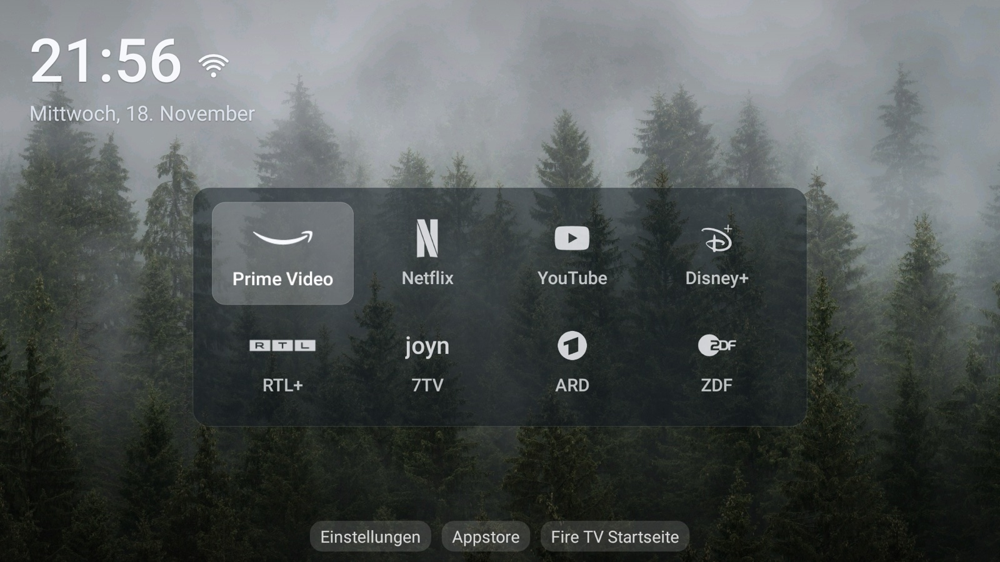

# FireTV_Optimization_CleanFrame

A calmer, faster Amazon Fire TV Stick without root: a [CleanFrame](https://github.com/nthnclrk/CleanFrame)-style home
screen, quieter settings and fewer background services, all over ADB on Wi-Fi.



*Fire TV Stick 2nd gen (AFTT), Fire OS 5.2.9.5. Clock with Wi-Fi signal, the owner's streaming apps as white marks on a
dark glass dock, and three buttons: Settings, Appstore, Fire TV home. Labels are German on this stick.*

Built and measured on one Fire TV Stick 2nd gen, the most locked-down firmware in the family: Fire OS 5 refuses
`pm disable-user`, `pm hide` for Amazon's apps, uninstalling and accessibility services over ADB. Everything here works
within those limits. Newer sticks allow more; see [Fire TV Stick versions](#fire-tv-stick-versions).

## What it does

| | Before | After |
|---|---|---|
| Home screen after power-on | Amazon's home; own home 66 s after the screen came on | Own home on screen 1.7 s **before** the screen comes on |
| Home button | Amazon's home with ads for ~5 s, then the own home | Own home at once (overlay cover during Android's 5 s app-switch delay) |
| Background processes 5 min after boot | 187 | 170 |
| Free RAM 5 min after boot (actually free) | 62 MB | 211 MB |
| Screensaver process | 85 MB idle | off |
| Privacy | usage data, app data, interest-based ads, cookies on | off |
| Appstore | through Amazon's home | button on the home screen, opens the store front |

### Parts

- **[firehome](docs/firehome.md)**: a small native home screen (Java, no Gradle). Watches the system log for Home
  presses (`READ_LOGS`), starts with the first network broadcast at boot instead of the late `BOOT_COMPLETED`, covers
  Amazon's home during the 5 s app-switch delay, ends ~32 unused Amazon services in the background, and opens the
  Appstore, Settings and Amazon's home on demand.
- **[Settings](docs/settings.md)**: privacy switches, autoplay, screensaver, animations, with undo for each.
- **[Debloat lists and tools](examples/README.md)**: backup-first `tools/disable.sh` / `tools/restore.sh`, a pure-Python
  ADB client (`tools/tv.py`), a browser remote (`tools/remote.py`), Fire TV app pairing for sticks without a remote
  (`tools/firetv.py`), and `tools/svg2vd.py` for white app marks.
- **[Findings](docs/fire-os-5-findings.md)**: what Fire OS 5 allows, the measured boot timeline, the app-switch delay,
  package facts (Prime Video is `com.amazon.firebat`), and how to work with the stick without hanging it.

## Quick start

The easiest way is to let a coding agent do it: open this repo in [Claude Code](https://claude.com/claude-code) and paste
the prompt from **[PROMPT.md](PROMPT.md)** with your stick's IP. It plans first, asks which apps you use, and verifies
every step.

By hand:

```sh
git clone https://github.com/X-Rayven/FireTV_Optimization_CleanFrame.git && cd FireTV_Optimization_CleanFrame
python3 -m venv tools/venv && tools/venv/bin/pip install -r tools/requirements.txt
export TV_HOST=192.168.1.50                      # the stick: Settings > My Fire TV > About > Network
tools/venv/bin/python -I tools/tv.py --probe     # accept "Allow USB debugging?" on the TV

# 1. settings: docs/settings.md (menu + three adb commands)
# 2. home screen: set APPS in firehome/src/com/firehome/HomeActivity.java, then
PATH="/opt/homebrew/opt/openjdk@17/bin:$PATH" firehome/install.sh
# 3. Fire OS 6+ only: HIDE= tools/disable.sh examples/<closest>/debloat.txt   (small batches)
```

Undo: `firehome/install.sh --remove` brings Amazon's home back; `tools/restore.sh <list> com.amazon.tv.launcher`
replays the recorded package states; the settings undo is in `docs/settings.md`. Nothing is uninstalled.

## Fire TV Stick versions

🟢 tested with this repo · 🔴 not tested

| Status | Device | Model | Year | Fire OS / Android |
|---|---|---|---|---|
| 🟢 | Fire TV Stick 2nd gen | AFTT | 2016 | Fire OS 5.2.9.5 / Android 5.1 |
| 🔴 | Fire TV Stick 1st gen | AFTM | 2014 | Fire OS 5 / Android 5.1 |
| 🔴 | Fire TV Stick 4K | AFTMM | 2018 | Fire OS 6 / Android 7.1 |
| 🔴 | Fire TV Stick 3rd gen | AFTSS | 2020 | Fire OS 7 / Android 9 |
| 🔴 | Fire TV Stick Lite | AFTSSS | 2020 | Fire OS 7 / Android 9 |
| 🔴 | Fire TV Stick 4K Max | AFTKA | 2021 | Fire OS 7 / Android 9 |
| 🔴 | Fire TV Stick 4K (2nd gen) | AFTKM | 2023 | Fire OS 8 / Android 11 |
| 🔴 | Fire TV Stick 4K Max (2nd gen) | AFTKRT | 2023 | Fire OS 8 / Android 11 |
| 🔴 | Fire TV Stick 4K Select | – | 2025 | reportedly Vega OS (not Android): not applicable |

What to expect on each, and what to change for Fire OS 6-8 (debloat with `pm disable-user`, overlay permission on
Android 8+, accessibility takeover), is in **[docs/adapting.md](docs/adapting.md)**. Tested another stick? Turn its dot
green with your measurements in a pull request.

## Fire TV lists

Debloat lists in `examples/`, one folder per device. On Fire OS 5 they document intent only (see above).

| TV | OS |
|---|---|
| Amazon Fire TV Stick 2nd gen (AFTT, tank), India | Fire OS 5.2.9.5 / Android 5.1 |
| Amazon Fire TV Stick 2nd gen (AFTT, tank), Germany | Fire OS 5.2.9.5 / Android 5.1 |
| Amazon Fire TV Stick 4K, 1st gen 2018 (AFTMM, mantis) | Fire OS 6.7.1.1 / Android 7.1 |
| Insignia 55" F30 4K Fire TV (NS-55F301NA25, AFTDCT31, duckie) | Fire OS 7 / Android 9 |
| Toshiba Fire TV (AFTHA004, hazel) | Fire OS 7 / Android 9 |

## Related projects

[Homestead](https://github.com/Sarg338/Homestead), [firestrip](https://github.com/WB2024/firestrip),
[Firestick-Cleaner-And-Launcher-Replacer](https://github.com/niftiest/Firestick-Cleaner-And-Launcher-Replacer) and
[firetv-glass-launcher](https://github.com/ivantrj/firetv-glass-launcher) solve the same problem on newer Fire OS with
`pm disable-user` and accessibility services. [docs/related-projects.md](docs/related-projects.md) compares them: what
this repo took, why it does not work on Fire OS 5, and when they are the better choice.

## Safety

- **With no remote, Wi-Fi is the only way in.** Every Wi-Fi provisioning, remote, Bluetooth and pairing service is
  kept. A factory reset is no fallback: setup after a reset needs a physical remote.
- Network ADB is full control of the stick for anyone on your network. Switch it off when you are done, once you have
  another way to control the stick.
- Your ADB key and Fire TV pairing token live in `tools/adbkey/`, snapshots in `backup/`; both are gitignored.
- Use at your own risk; tested on one stick.

## Credits and licence

MIT, see [LICENSE](LICENSE). Built on [debloat-fire-stick-claude-code](https://github.com/whyashthakker/debloat-fire-stick-claude-code)
and [CleanYourTV](https://github.com/Gathin23/cleanyourtv) (MIT). The home screen design, marks and photo come from
[CleanFrame](https://github.com/nthnclrk/CleanFrame) (MIT), [Simple Icons](https://simpleicons.org) (CC0),
[Custom Brand Icons](https://github.com/elax46/custom-brand-icons) (MIT) and Dejan Zakic on Unsplash; details in
[THIRD_PARTY_NOTICES.md](THIRD_PARTY_NOTICES.md). Brand marks belong to their owners; no affiliation with Amazon or any
streaming service.
